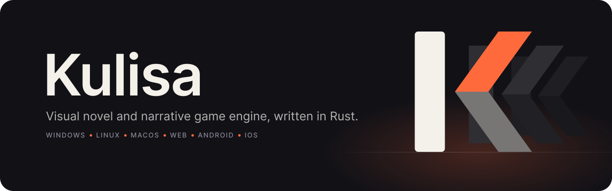
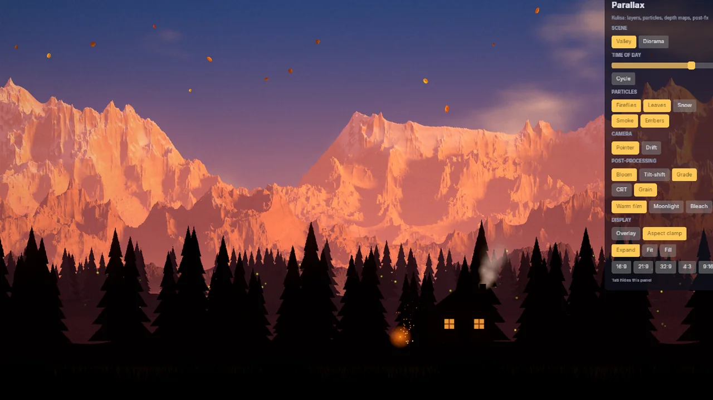
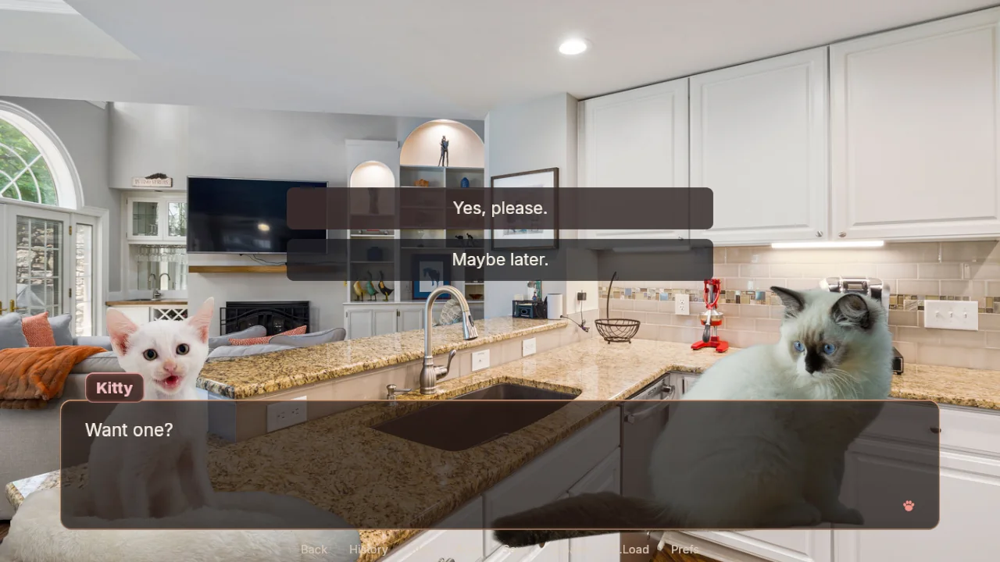
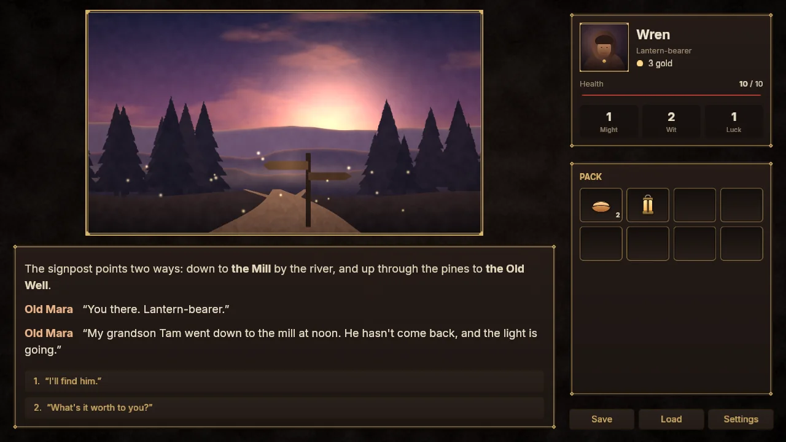
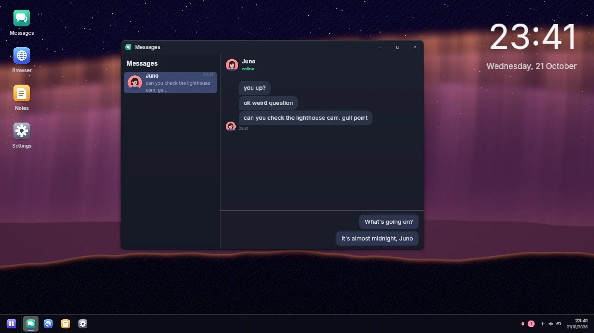
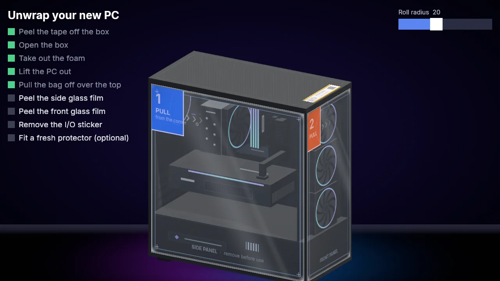

<p align="center">
  <picture>
    <source media="(prefers-color-scheme: dark)" srcset="docs/brand/banner-dark.svg">
    <source media="(prefers-color-scheme: light)" srcset="docs/brand/banner-light.svg">
    
  </picture>
</p>

<p align="center">
  <a href="https://github.com/nikolchaa/Kulisa/actions/workflows/ci.yml"></a>
  <a href="LICENSE"></a>
  
  
</p>

<p align="center">
  <a href="#quick-start">Quick start</a> ·
  <a href="docs/API.md">Luau API</a> ·
  <a href="docs/DESIGN.md">Design</a> ·
  <a href="#templates-and-demos">Templates and demos</a>
</p>

---

*Kulisa* is Serbian for stage scenery. The engine builds the stage: rendering, text, input,
audio, scripting, saves and rollback. It has no look of its own. The classic visual novel
interface is a template written in Kulisa's own scripting, so a game can keep it, restyle it,
or throw it away and become a chat app, a text RPG or a desktop simulator.

<p align="center">
  
</p>

## Why Kulisa

- **No built-in look.** The engine never draws the story; your scripts do. Templates and demos
  use only the public API, so anything they do, your game can do.
- **Two scripting layers.** Writers use `.kulisa` story files, close to Ren'Py, with errors
  that name the file, line and column. Programmers use [Luau](https://luau.org) and can touch
  everything.
- **Six platforms from one folder.** Windows, Linux, macOS, Web (WebGPU and WebGL2), Android
  and iOS, all built and tested in CI.
- **Fast and lean.** A batched GPU renderer on wgpu with WGSL shaders, effect chains, meshes and
  GPU particles. Small builds, instant start, quality tiers that step down on slow devices.
- **Built for touch, mouse, keyboard and gamepad.** Gestures, safe areas, phone and tablet
  layouts, focus navigation, haptics and sensors.
- **Rollback and update-safe saves.** Scroll back through the story; saves survive story edits.
- **Live reload.** Edit a story, image or shader and see it in the running game. Luau changes
  restart the game on the line you were on.
- **Comes from Ren'Py?** `kulisa import` turns a Ren'Py project's scripts and art into a
  Kulisa game.

## Two layers

The story, for writers:

```renpy
define mila = Character("Mila", { color = "#e8a0bf" })
default trust = 0

label start:
    scene bg station with fade
    show mila smile at left
    mila "You came. I wasn't sure you would."
    menu:
        "Of course I did.":
            $ trust += 1
            mila "Then let's go before the last train leaves."
        "I almost didn't.":
            mila "Honest. I'll take it."
```

The presentation, for programmers. The engine calls handlers; the game decides what a line
looks like:

```luau
kulisa.load_font("fonts/Inter-Regular.ttf")
local box = kulisa.sprite({ x = 80, y = 800, width = 1760, height = 220, tint = "#111116cc" })
local line = kulisa.text({ parent = box, x = 40, y = 32, size = 40, wrap = 1680, cps = 45 })

kulisa.on("say", function(say)
    line.text = if say.who then `{say.who.name}: {say.text}` else say.text
end)
kulisa.on("tap", function()
    if line.complete then kulisa.story.next() else line:skip() end
end)

kulisa.story.load()
kulisa.story.start()
```

The templates do the same at full scale: say boxes, choices, history, save and load screens,
preferences, all of it editable Luau.

## Quick start

You need [Rust](https://rustup.rs) (stable). There are no prebuilt releases yet; the `kulisa`
tool builds games from the engine source.

```sh
git clone https://github.com/nikolchaa/Kulisa
cd Kulisa
cargo install --path crates/kulisa-cli

kulisa new "Cat Tales" --dir cat-tales   # from the classic-vn template
cd cat-tales
kulisa run                               # play it here, with live reload
kulisa run --web                         # or in the browser
kulisa build web                         # or android, ios, and windows/linux/macos
```

Builds land in `cat-tales/dist/<target>`. Desktop builds are made on that desktop, Android
needs the Android SDK and NDK, iOS a Mac with Xcode. `kulisa help` lists everything, including `kulisa import` for Ren'Py projects.

## Templates and demos

<table>
  <tr>
    <td width="50%"></td>
    <td width="50%"></td>
  </tr>
  <tr>
    <td><b><a href="templates/classic-vn">classic-vn</a></b>: the Ren'Py-style visual novel. Skip, auto, rollback, history, saves, preferences, touch and gamepad.</td>
    <td><b><a href="templates/text-rpg">text-rpg</a></b>: an illustrated text adventure with stats, inventory and a phone layout.</td>
  </tr>
  <tr>
    <td></td>
    <td></td>
  </tr>
  <tr>
    <td><b><a href="templates/desktop-os">desktop-os</a></b>: a story told through a fake desktop: windows, chat, a browser, notifications.</td>
    <td><b><a href="demos/pc-unwrap">pc-unwrap</a></b>: unbox a PC and peel its films. Meshes, cloth, custom shaders, sound and haptics.</td>
  </tr>
</table>

Also in [`demos/`](demos): **parallax** (layers, terrain, GPU particles, post effects, a
display lab for every screen shape), **interact** (drag and drop, gestures, gamepads, text
input, sensors) and **smoke** (a small tour of the API).

```sh
cargo run -p kulisa-player -- demos/parallax
```

## Status

Kulisa is young. The engine, the `kulisa` tool, three templates and four demos work on all six
platforms, and CI builds and tests every commit. The API can still change between versions,
and there are no prebuilt releases yet. [docs/DESIGN.md](docs/DESIGN.md) has the milestones,
the architecture and the reasons behind each decision.

## Repository

| Path | What |
|---|---|
| [`crates/`](crates) | The engine: renderer, text, audio, story language and VM, UI, Luau bindings, runtime, CLI |
| [`templates/`](templates) | Starting points for games (`kulisa new --template`) |
| [`demos/`](demos) | Showcases, written only against the public API |
| [`docs/`](docs) | [Luau API](docs/API.md), [design and decision log](docs/DESIGN.md), [brand](docs/brand/BRAND.md) |

## License

[MIT](LICENSE). Bundled fonts are under the SIL Open Font License (see each `fonts/` folder).
